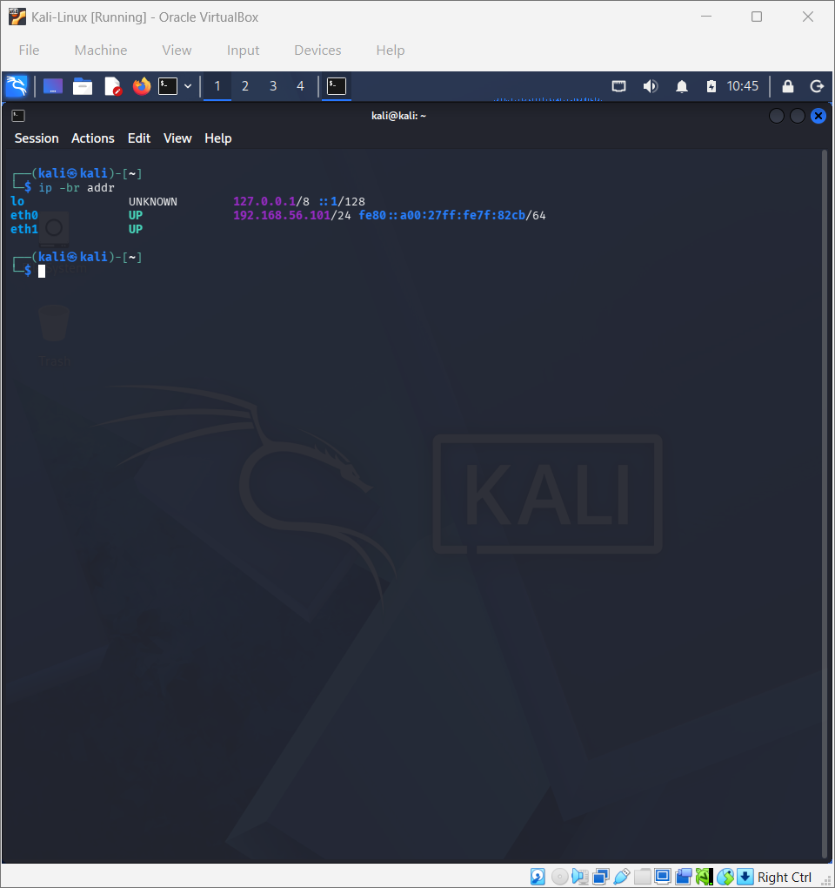
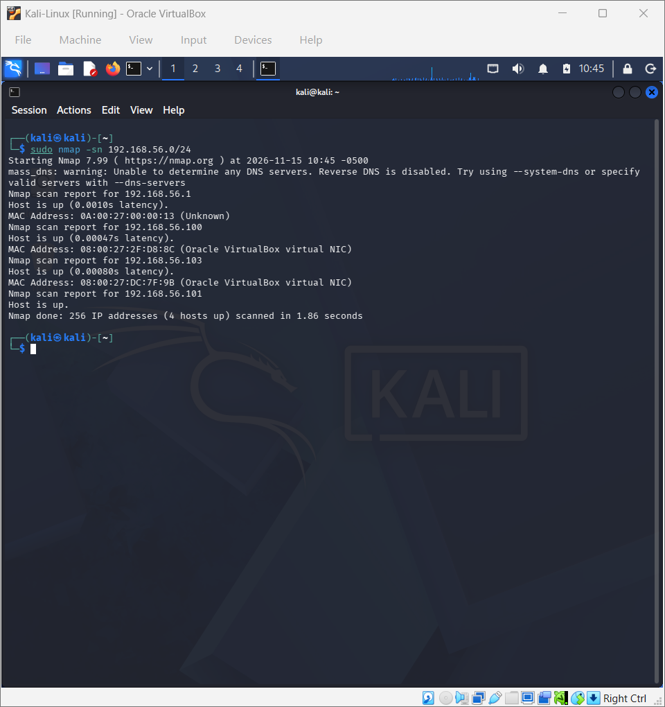
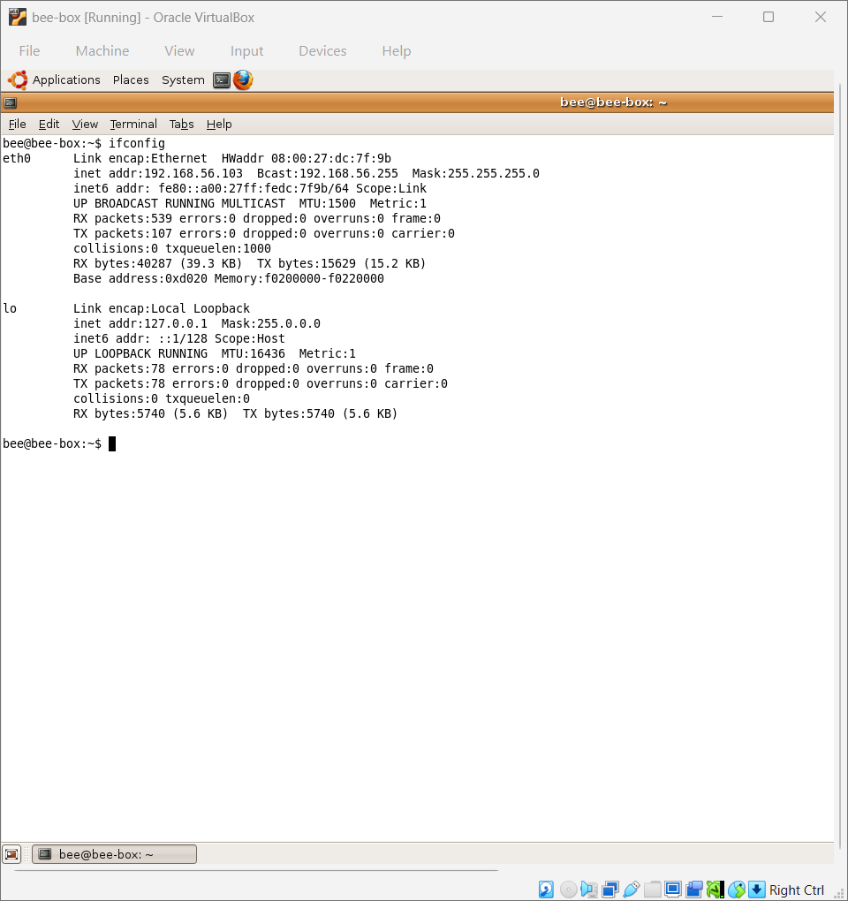
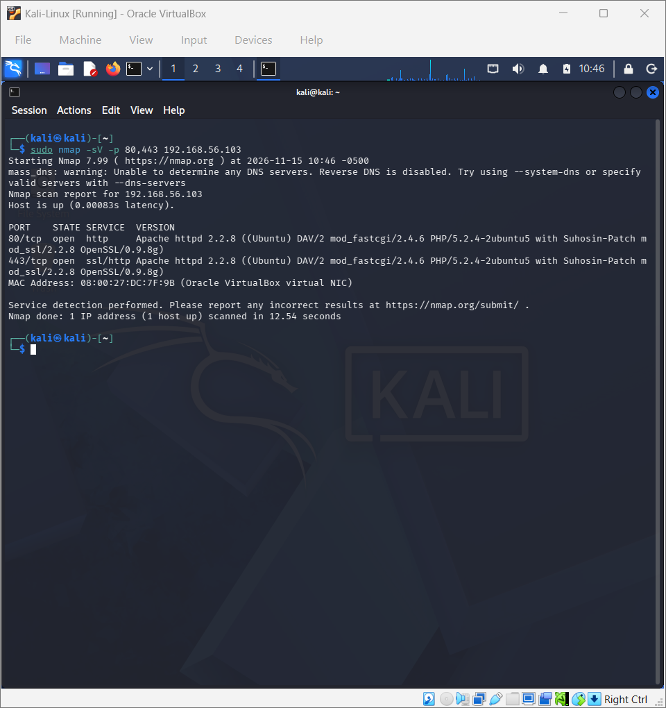

# Lab 4 — Active Reconnaissance (Footprinting)

Name: MUHAMMAD AZIM DANIAL BIN NOR HALIM
Group : L01-B03

## Scope

I only scanned my own vulnerable machine at home. I did not scan any real
website. Both machines are on a private Host-Only network, so nothing goes
outside.

## 1. Target Setup (Victim)

My target is bee-box. It is a vulnerable web app made for practice. I put it in
VirtualBox and set it on a private Host-Only network (192.168.56.0/24). Its IP
address is 192.168.56.103.


## 2. Own Host (Attacker)

My attacker machine is Kali Linux. First I checked my own IP address.

```bash
ip -br addr
```

My Kali IP is 192.168.56.101. This is the same network as bee-box.



Then I searched for the victim on the network.

```bash
sudo nmap -sn 192.168.56.0/24
```



The results:

- 192.168.56.1 — the network (ignore)
- 192.168.56.100 — another VM (ignore)
- 192.168.56.101 — my Kali
- 192.168.56.103 — bee-box, my target

I also checked the IP from inside bee-box to make sure. The MAC address matched.



## 3. Findings, Evidence and Limitations

I scanned only the web ports (80 and 443).

```bash
sudo nmap -sV -p 80,443 192.168.56.103
```



Findings:

- Port 80 (HTTP) is open. It runs Apache 2.2.8, PHP 5.2.4, OpenSSL 0.9.8g.
- Port 443 (HTTPS) is open. It runs the same software.

What it means:

The website works on both HTTP and HTTPS. The software is very old (around 2008).
This means the server is outdated and may have known weakness.

Limitations:

The version comes from the service banner, and a banner can be faked. Also, old
does not mean it is really vulnerable. I did not exploit it, so I can only say it
looks outdated, not confirmed. Some services can hide behind a firewall. I only
scanned port 80 and 443. The result is only for the time I scanned.

## Commands I used

```bash
ip -br addr
ip route
sudo nmap -sn 192.168.56.0/24
sudo nmap -sV -p 80,443 192.168.56.103
```
